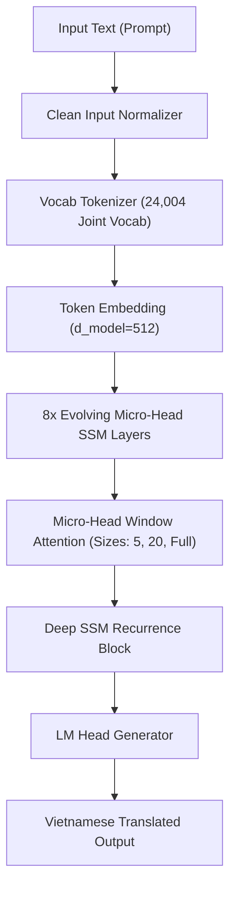

# 🧠 TÀI LIỆU KIẾN TRÚC MÔ HÌNH (MODEL ARCHITECTURE GUIDE)
> **Evolving Micro-Head State Space Model (SSM) cho Dịch Thuật Trung - Việt**

---

## 📑 MỤC LỤC
1. [Tổng Quan Kiến Trúc (Architecture Overview)](#1-tổng-quan-kiến-trúc)
2. [Chi Tiết Micro-Head Window Attention & SSM Recurrence](#2-chi-tiết-micro-head-window-attention--ssm-recurrence)
3. [Tối Ưu Bộ Từ Vựng (24,004 Tokens Joint Vocab)](#3-tối-ưu-bộ-từ-vựng-24004-tokens-joint-vocab)
4. [Thông Số Kỹ Thuật (Model Hyperparameters)](#4-thông-số-kỹ-thuật)
5. [Quy Trình Huấn Luyện & Loss Function](#5-quy-trình-huấn-luyện--loss-function)

---

## 1. TỔNG QUAN KIẾN TRÚC

Mô hình **Evolving Micro-Head SSM** kết hợp sức mạnh biểu diễn của **Cục bộ (Local Attention Windows)** và khả năng truy xuất quy mô lớn của **State Space Models (SSM)**:

---

## 2. CHI TIẾT MICRO-HEAD WINDOW ATTENTION & SSM RECURRENCE

1. **Micro-Head Spatial Multi-Headed Window:**
   * Thay vì dùng 8 hay 16 Attention Head lớn thông thường, mô hình chia nhỏ không gian Vector Embedding thành **16 Micro-Heads**.
   * Các Cửa Sổ Ngữ Cảnh (Window Sizes): `(5, 20, None)`
     * **Cửa số 5:** Học cú pháp và ranh giới từ Hán-Việt ngắn.
     * **Cửa số 20:** Học ngữ pháp cụm từ và thành ngữ (Yanyu/Chengyu).
     * **Cửa số None (Full):** Bao quát toàn bộ câu văn/đoạn văn ngữ cảnh dài.

2. **Khả Năng Chống Ô Nhiễm Padding (Unpadded Concatenation):**
   * Sử dụng `CMLMSeqCollate` đẩy toàn bộ Token `<pad>` (ID 3) về cuối chuỗi 100%.
   * Giúp cơ chế biến thiên trạng thái SSM không bị nhiễu bởi các token đệm.

---

## 3. TỐI ƯU BỘ TỪ VỰNG (24,004 TOKENS JOINT VOCAB)

* **Bộ Từ Vựng Dùng Chung (Joint Vocabulary):** Tích hợp từ đơn, từ ghép Hán-Việt phổ biến nhất qua thuật toán SentencePiece BPE.
* **4 Special Control Tokens (1 Token Duy Nhất):**
  * `<glossary>` (ID `24000`)
  * `</glossary>` (ID `24001`)
  * `<src>` (ID `24002`)
  * `</src>` (ID `24003`)
* **Ký Tự Xuống Dòng Byte-Fallback:**
  * Ký tự `\n` được mã hóa thành **ID `14` (`<0x0A>`)**, giải mã bảo toàn 100% ngắt dòng.

---

## 4. THÔNG SỐ KỸ THUẬT (MODEL HYPERPARAMETERS)

| Thông Số Kỹ Thuật | Giá Trị Cấu Hình | Diễn Giải Chi Tiết |
| :--- | :---: | :--- |
| `d_model` | `512` | Kích thước ẩn (Hidden dimension). |
| `num_micro_heads` | `16` | Số lượng Micro Attention Heads. |
| `num_encoder_layers` | `8` | Số tầng khối SSM / Encoder. |
| `dim_feedforward` | `2048` | Kích thước tầng Feedforward FFN. |
| `max_seq_len` | **`2048`** | Chiều dài chuỗi tối đa (Context Length). |
| `batch_size` | **`16`** | Kích thước Batch huấn luyện trên GPU. |
| `accum_steps` | `2` | Gradient Accumulation Steps (Tương đương Effective Batch 32). |
| `dropout` | `0.1` | Tỷ lệ Dropout chống Overfitting. |
| `learning_rate` | `3e-4` | Peak Learning Rate với Cosine Decay. |
| `precision` | `BF16` | Bfloat16 Mixed Precision trên Card NVIDIA. |

---

## 5. QUY TRÌNH HUẤN LUYỆN & LOSS FUNCTION

* **Loss Function:** `nn.CrossEntropyLoss(ignore_index=3, reduction='sum')`.
* **Optimizer:** `AdamW(betas=(0.9, 0.98), weight_decay=0.01)`.
* **Scheduler:** `SSMLRScheduler` (Warmup 3.000 steps, Cosine decay về min LR `1e-5`).
