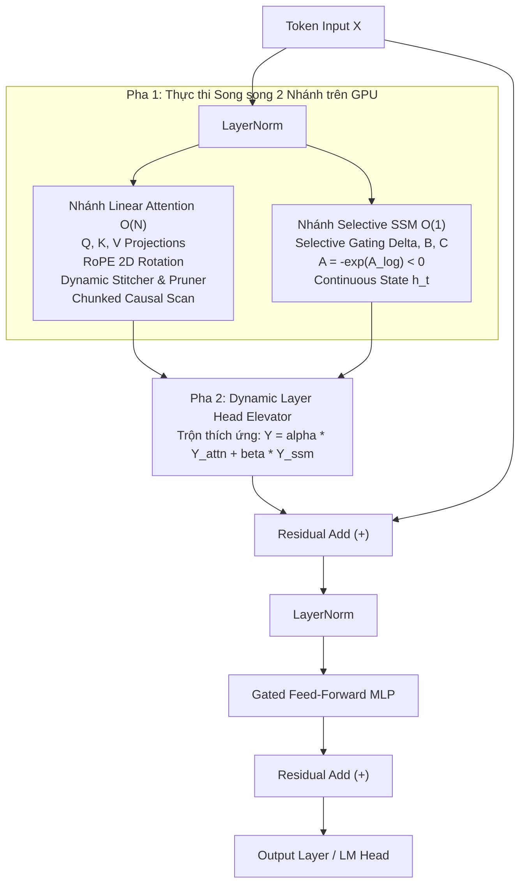

# ⚡ Evolving-Head Hybrid Attention-SSM (Chinese → Vietnamese NMT)

<div align="center">

[](https://www.python.org/)
[](https://pytorch.org/)
[](https://developer.nvidia.com/cuda-toolkit)
[](LICENSE.txt)
[](https://uet.vnu.edu.vn/)

**Nghiên cứu Kiến trúc Lai Hybrid Attention-SSM phục vụ Chuyển phong cách Văn bản và Dịch thuật Hán - Việt**  
*Khóa luận Tốt nghiệp Đại học — Trường Đại học Công nghệ, Đại học Quốc gia Hà Nội (VNU-UET)*

**Tác giả:** Hà Vũ Công (MSSV: 23020014) | **Cán bộ hướng dẫn:** TS. Nguyễn Văn Vinh

[Kiến trúc](#-kiến-trúc-mô-hình) • [Kết quả Thực nghiệm](#-kết-quả-thực-nghiệm-đối-chứng-200k-steps) • [Cấu trúc Thư mục](#-cấu-trúc-thư-mục-dự-án) • [Cài đặt & Chạy](#-hướng-dẫn-cài-đặt--sử-dụng) • [Báo cáo Luận văn](#-luận-văn--slide-thuyết-trình)

</div>

---

## 📌 Giới thiệu Đề tài

Dịch thuật máy văn bản trường thiên (tiểu thuyết chương hồi, văn bản Hán - Việt cổ phong) đặt ra hai thách thức kỹ thuật lớn cho các kiến trúc hiện nay:
1. **Mô hình Seq2Seq truyền thống (Encoder-Decoder):** Bó hẹp ở cấp câu đơn lẻ ($\le 512$ tokens), dẫn tới đứt gãy ngữ cảnh dài, quên tên nhân vật và sai lệch danh xưng xưng hô.
2. **Mô hình Transformer Decoder-Only:** Mở rộng được ngữ cảnh nhưng vấp phải chi phí chú ý bậc hai $O(N^2)$ và sự bùng nổ tuyến tính của bộ nhớ đệm KV-Cache ($16\text{ KB/token}$), gây tràn bộ nhớ VRAM (OOM) trên phần cứng máy tính cá nhân.

Đề tài đề xuất kiến trúc **Evolving-Head Hybrid Attention-SSM (71.97M tham số)** — kết hợp sức mạnh biểu diễn ngữ nghĩa toàn cục của **Causal Linear Scan Attention $O(N)$** với khả năng nén lịch sử dịch vô hạn ở trạng thái hằng số $O(1)$ của **Selective State Space Model (Mamba-style)**, cho phép suy luận siêu tốc và vận hành ổn định trên thiết bị biên / GPU cá nhân (NVIDIA RTX 5060 Ti 16GB).

---

## 🧠 Kiến trúc Mô hình (Evolving Hybrid SSM)

Mỗi khối tầng lai đa tầng (`EvolvingHeadSSMBlock`) bao gồm hai nhánh độc lập thực thi đồng thời (Parallel Dual-Branch) từ đầu vào chuẩn hóa chung `LayerNorm(x)`:



### Điểm nổi bật về kỹ thuật:
* **RoPE (Rotary Position Embedding):** Mã hóa vị trí quay 2D bảo toàn quan hệ khoảng cách tương đối cho ngữ cảnh dài.
* **DynamicHeadStitcher & HeadPruner:** Phân cụm và lọc các micro-head gây nhiễu trước khi tính toán liên kết.
* **Causal Linear Scan theo Chunk ($C = 64$):** Thay thế Softmax Attention $O(N^2)$ bằng kernel đối xứng $\phi(x) = \text{ELU}(x) + 1.0 \ge 0$, đạt độ phức tạp tuyến tính $O(N)$.
* **Continuous State Recurrence $O(1)$:** Trong suy luận tự hồi quy, trạng thái ẩn $h_t$ chỉ chiếm cố định **1.54 MB**, không sử dụng KV-Cache, tốc độ sinh từ không bị suy giảm theo độ dài văn bản.
* **Chunked Cross-Entropy Loss (`models/chunked_loss.py`):** Chia nhỏ bước tính đạo hàm ma trận Logits 40,960 tokens, **giảm 60% đỉnh VRAM**, ngăn chặn lỗi OOM khi huấn luyện trên GPU 16GB.

---

## 📊 Kết quả Thực nghiệm Đối chứng (200k Steps)

Thực nghiệm đối chứng công bằng (Apple-to-Apple) độc lập giữa **Evolving Hybrid SSM** và **Standard Transformer Baseline** trên cùng tập dữ liệu song ngữ 34.3 triệu câu và cùng phần cứng GPU **NVIDIA GeForce RTX 5060 Ti 16GB**:

| Tiêu chí Đánh giá | Standard Transformer | Evolving Hybrid SSM (Đề xuất) | Đánh giá Ưu thế |
| :--- | :---: | :---: | :---: |
| **Quy mô tham số tổng** | 68.2M | **71.97M** | Tương đương ($d=512$, 8 layers) |
| **Best Validation Loss** | 0.2017 | **0.1794** | 🟢 **Mô hình Lai hội tụ sâu hơn** |
| **Validation Perplexity (PPL)** | 1.223 | **1.196** | 🟢 **Độ bất định thấp hơn** |
| **BLEU - Tiên hiệp / Tu chân** | 32.1 | **34.2** | 🟢 **+2.1 BLEU (Nhớ thực thể cổ phong)** |
| **BLEU - Kiếm hiệp / Lịch sử** | 30.5 | **31.8** | 🟢 **+1.3 BLEU (Văn phong mượt mà)** |
| **Dung lượng bộ đệm tại 2M tokens** | 30.52 GB (KV-Cache) | **1.54 MB** (Hidden State) | 🟢 **Tiết kiệm 99.99% bộ nhớ** |
| **Ngưỡng tràn bộ nhớ (VRAM OOM)** | Sập OOM tại ~900k tokens | **Vận hành phẳng 542 MB VRAM** | 🟢 **Xóa bỏ hoàn toàn rào cản OOM** |

---

## 📁 Cấu trúc Thư mục Dự án

```text
report_final_translate_zi_to_vi/
├── models/                         # 🧠 Kiến trúc Mạng Nơ-ron & Toán tử GPU Tối ưu
│   ├── micro_head_ssm.py           # Mô hình đề xuất Evolving-Head Hybrid SSM (71.97M)
│   ├── transformer_decoder.py      # Mô hình đối chứng Standard Transformer Baseline
│   ├── chunked_loss.py             # Bộ tính Chunked Cross-Entropy Loss giảm 60% VRAM
│   └── fused_ops.py                # Toán tử kernel gộp tối ưu thông lượng
│
├── benchmarks/                     # 📈 Đo đạc BLEU, Sinh đồ thị & Dữ liệu Kiểm thử
│   ├── run_standardized_bleu_benchmark_200k.py # Benchmark BLEU, SacreBLEU, chrF++, ROUGE
│   ├── benchmark_translation_comparison.py     # Đo đạc thông lượng tok/s & độ trễ
│   ├── generate_thesis_charts.py               # Script sinh toàn bộ biểu đồ vector luận văn
│   ├── plot_comparison_loss_ppl.py             # Vẽ đường cong hội tụ Loss & PPL 200k steps
│   ├── plot_detailed_training_comparison.py    # Phân tích Training Dynamics
│   ├── benchmark_test_dataset.json             # Bộ 50 câu kiểm thử chuẩn hóa đa miền
│   └── benchmark_bleu_200k_results.json        # Dữ liệu kết quả đo đạc thực nghiệm
│
├── docs/                           # 📚 Báo cáo Chi tiết & Tài liệu Kỹ thuật
│   ├── KET_QUA_KIEM_THU_DICH_THUAT_DA_MIEN.md  # Báo cáo đánh giá chất lượng dịch thuật 9 miền
│   ├── MODEL_ARCHITECTURE_GUIDE.md             # Hướng dẫn chi tiết luồng Tensor 6 bước
│   ├── INPUT_PIPELINE_GUIDE.md                 # Hướng dẫn tiền xử lý & Glossary Conditioning
│   ├── DATASET_CHUAN_1TO1_4PCT.md              # Phân tích thống kê ngữ liệu song ngữ
│   └── ban_dich_output.md                      # Kết quả dịch thực tế xuất ra từ CLI tool
│
├── tests/                          # 🧪 Bộ Kiểm thử Ứng suất & Hiệu năng Phần cứng
│   ├── test_2m_token_scaling.py    # Kiểm thử mở rộng cực hạn 2,000,000 tokens
│   ├── test_vram_scaling_comparison.py         # Đo đạc chi tiết tiêu thụ VRAM
│   ├── test_comprehensive_inference_comparison.py # So sánh độ trễ suy luận
│   └── ...                         # Các bài test tái hồi và tính toán gradient
│
├── uet-graduation-thesis/          # 🎓 Báo cáo Luận văn Tốt nghiệp & Slide Beamer
│   ├── main.tex & main.pdf         # Toàn văn luận văn tốt nghiệp (LaTeX + Vector PDF)
│   ├── slides.tex & slides.pdf     # Slide thuyết trình bảo vệ 27 trang (Beamer)
│   ├── SPEAKER_NOTES.md            # Kịch bản lời thoại bảo vệ trước hội đồng (15-18 phút)
│   └── fig_*.pdf                   # Toàn bộ biểu đồ đồ họa vector chuẩn in ấn
│
├── vocab/                          # 📖 Bộ Từ vựng BPE & Danh xưng Hán - Việt
│   ├── joint_vocab.json            # Từ điển song ngữ BPE 40,960 tokens
│   └── Names_NuocNgoai_Vocab.json  # Từ điển tên riêng nước ngoài & thực thể đặc thù
│
├── config.py                       # ⚙️ Cấu hình siêu tham số toàn hệ thống
├── train.py                        # 🚀 Script huấn luyện mô hình Hybrid Attention-SSM
├── train_transformer.py            # 🚀 Script huấn luyện mô hình Transformer đối chứng
├── translate.py                    # 🔮 Script suy luận dịch thuật API / Interactive CLI
├── infer_cli.py                    # 🛠️ Công cụ dòng lệnh dịch câu đơn hoặc dịch file
├── demo_app.py                     # 🌐 Ứng dụng Web Demo trực quan (Gradio UI)
├── dataset_loader.py               # 📦 Dataloader nạp ngữ liệu huấn luyện
├── dataset_binary_loader.py        # ⚡ Binary Memory-Mapped Dataloader 34.3M câu (<400MB RAM)
├── clean_input.py                  # 🧹 Bộ tiền xử lý văn bản & Glossary Prompt Builder
├── vocab_tokenizer.py              # 🔤 Module tokenizer BPE tích hợp thẻ điều khiển
├── README.md                       # 📄 Tài liệu tổng quan dự án
├── .gitignore                      # 🛡️ Bộ lọc loại bỏ logs, checkpoints nặng và data thô
└── .agignore                       # 🛡️ Bộ lọc tối ưu ngữ cảnh IDE
```

---

## 🚀 Hướng dẫn Cài đặt & Sử dụng

### 1. Yêu cầu Hệ thống
* **Hệ điều hành:** Linux (Ubuntu 22.04 / 24.04 khuyên dùng)
* **Python:** $\ge 3.10$
* **GPU:** NVIDIA GPU hỗ trợ CUDA 12.0+ (Tối ưu trên card có 8GB - 16GB VRAM, ví dụ RTX 3060, 4060, 5060 Ti)

```bash
# Clone repository
git clone https://github.com/congkx123789/report_final_translate_zi_to_vi.git
cd report_final_translate_zi_to_vi

# Cài đặt các thư viện cần thiết
pip install torch torchvision torchaudio --index-url https://download.pytorch.org/whl/cu126
pip install gradio sacrebleu nltk rouge-score matplotlib numpy
```

---

### 2. Dịch thuật Trực tiếp (CLI Inference)

* **Dịch một câu tiếng Trung qua dòng lệnh:**
  ```bash
  python3 infer_cli.py --checkpoint checkpoints/ssm_model_best.pt --text "林动眼神微凝，体内元力呼啸而出。"
  ```

* **Dịch tương tác thời gian thực trên Terminal:**
  ```bash
  python3 translate.py --checkpoint checkpoints/ssm_model_best.pt --beam 1 --interactive
  ```

* **Dịch toàn bộ một tệp văn bản/chương truyện và xuất file Markdown:**
  ```bash
  python3 infer_cli.py --checkpoint checkpoints/ssm_model_best.pt \
      --input-file input.txt \
      --output-file output.md
  ```

---

### 3. Khởi chạy Giao diện Web Trực quan (Gradio Web UI)

Mở giao diện so sánh trực quan đối đầu giữa mô hình Hybrid SSM và Transformer:

```bash
python3 demo_app.py
```
👉 Mở trình duyệt và truy cập: `http://localhost:7860`

---

### 4. Huấn luyện Mô hình (Training)

* **Huấn luyện mô hình Evolving-Head Hybrid SSM:**
  ```bash
  python3 train.py
  ```

* **Huấn luyện mô hình Transformer Baseline đối chứng:**
  ```bash
  python3 train_transformer.py
  ```

---

### 5. Chạy Kiểm thử Benchmark BLEU

```bash
python3 benchmarks/run_standardized_bleu_benchmark_200k.py
```

---

## 🎓 Luận văn & Slide Thuyết trình

Toàn bộ tài liệu báo cáo học thuật được lưu trữ trong thư mục [uet-graduation-thesis/](uet-graduation-thesis/):

* **Bản thảo Luận văn:** [main.tex](uet-graduation-thesis/main.tex) $\to$ Bản in hoàn chỉnh [main.pdf](uet-graduation-thesis/main.pdf)
* **Slide Thuyết trình Hội đồng:** [slides.tex](uet-graduation-thesis/slides.tex) $\to$ Bản trình chiếu [slides.pdf](uet-graduation-thesis/slides.pdf) (27 slide)
* **Kịch bản Thuyết trình:** [SPEAKER_NOTES.md](uet-graduation-thesis/SPEAKER_NOTES.md) (Hướng dẫn lời thoại chi tiết theo từng slide và bộ 10 câu hỏi phản biện của hội đồng)

**Biên dịch tài liệu bằng LuaLaTeX:**
```bash
cd uet-graduation-thesis
lualatex --interaction=nonstopmode main.tex
lualatex --interaction=nonstopmode slides.tex
```

---

## 📜 Giấy phép & Trích dẫn (License & Citation)

Dự án được phát hành theo giấy phép **MIT License**.

Nếu bạn sử dụng mã nguồn hoặc kết quả nghiên cứu này cho công trình học thuật của mình, vui lòng trích dẫn:

```bibtex
@bachelorthesis{havucong2026hybridssm,
  title     = {Nghiên cứu Kiến trúc Lai Hybrid Attention-SSM phục vụ Chuyển phong cách Văn bản và Dịch thuật Hán - Việt},
  author    = {Hà Vũ Công},
  school    = {Trường Đại học Công nghệ, Đại học Quốc gia Hà Nội (VNU-UET)},
  year      = {2026},
  address   = {Hà Nội, Việt Nam},
  advisor   = {TS. Nguyễn Văn Vinh}
}
```
